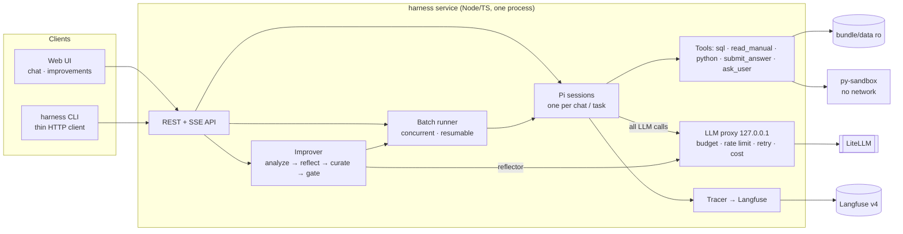

# Payments analyst on Pi — self-improving harness

Conversational analyst for the merchant-payments dataset, built on [Pi](https://pi.dev)
(`@earendil-works/pi-coding-agent@1.5.0`), with a self-improvement loop gated on the validation
set, cost/caching control and Langfuse tracing. Assignment: [`ASSIGNMENT.md`](ASSIGNMENT.md).
Results: [`REPORT.md`](REPORT.md). Full design, decisions and step log: [`SPEC.md`](SPEC.md).

**Scope:** everything in the Must and Should tiers. **MCP server (Extra mile) was cut** to finish
the improver in time; the API it would wrap (sessions, turns, feedback, versions) is in place.

## Architecture



## Run

```bash
cp .env.example .env          # fill in LITELLM_BASE_URL and LITELLM_API_KEY
docker compose up -d --build  # harness (API + UI) on :8080, Langfuse on :3000, py-sandbox
```

- **UI** — http://localhost:8080
  - *Chat:* version selector, streamed tool steps and text, structured answer and clarifying
    questions, per-turn cost / cache hit / latency / trace link, 👍/👎 (a 👎 comment reaches the improver).
  - *Improvements:* versions table (val mean of 3 runs, easy/hard, $/task, cache hit, p50/p95, what
    changed, gate numbers or reject reason), diff vs parent, serve / roll back a version, start an
    improve run with a budget and follow its progress.
- **Langfuse** — http://localhost:3000 (`admin@local.test` / `admin12345`): one trace per task or
  chat turn, a generation per LLM call (tokens, cache read/write, cost, latency), a span per tool call.
- **CLI** — runs inside the harness container, as a client of the service there (same budget cap,
  rate limiter and tracing). Task / answer files go through `./io`, mounted as `/io`:

```bash
docker compose exec harness harness solve --tasks /io/tasks.jsonl --version best --out /io/answers.jsonl
docker compose exec harness harness improve --generations 3 --budget-usd 30
docker compose exec harness harness report          # per-version metrics; --md for REPORT
```

Tasks without an `answer` field (e.g. the holdout) are solved without scoring.

Development on the host:

```bash
cd harness && npm ci
npm test                      # unit tests, no network, no LLM spend
npm run test:docker           # sandbox isolation tests (needs docker compose up)
npm run test:live             # live LLM tests (cost cents)
npm run serve                 # the service on the host (STATE_DIR defaults to ../state)
scripts/clean-clone-test.sh   # clone → compose up → health + one solve, on separate ports
```

## Versions

_Filled in at the end from `harness report --md` (see REPORT.md)._

<!-- versions:start -->
<!-- versions:end -->

## Key design decisions

Full table with trade-offs: SPEC §7.

- **One process owns every LLM call.** Pi talks to an in-process proxy on a random loopback port;
  only the proxy holds the LiteLLM key. It checks the budget before each call, enforces per-model
  rate limits, retries 408/429/5xx before the first byte, and records exact usage and cost (cache
  reads/writes included) in a SQLite ledger. UI, CLI, batch and improver share it.
- **Prompt laid out for caching.** Instructions → rules manual → data schema → playbook → skills
  form one stable prefix per version; the task goes into the user turn. Measured: 88–95 % of input
  tokens are cache reads in batch runs. An accepted `submit_answer` ends a batch turn (no extra call).
- **The agent never sees answers.** The batch runner passes only question + guidelines; DuckDB is
  sealed (SELECT only, no file access); model-written Python runs in a sandbox without network that
  cannot see `tasks/` or `scorer/`.
- **Improver = deterministic curator + statistical gate.** Opus proposes one change (playbook rule,
  skill, tool description or routing) from train trajectories; a curator applies it by rule id with
  dedup and size limits; leak and unknown-column checks reject task-specific content for $0;
  promotion needs the mean of 3 val runs to beat the parent's by T = 3 (derived from the noise between
  identical runs), net majority wins, no easy regressions and ≤ 1.3× cost per task.
- **Every proposal is a version** (rejected ones too) with its diff, metrics, reflection cost and
  reject reason; any promoted version can be served or rolled back.
- **Baseline chosen by rules fixed in advance**, revised once before the improver (Haiku → Sonnet);
  details and the train/val gap in REPORT.

## Budget and the holdout run

- The LiteLLM key has a $150 limit. Our own runs are capped at **$135** (`GLOBAL_BUDGET_USD`,
  enforced by the proxy before every LLM call); **$15 is reserved for the organisers' holdout run**.
- **Holdout cost estimate:** _$/task of the frozen best × number of holdout tasks — filled in at the
  end (REPORT.md)._
- **Honest caveat:** the spend ledger lives in the `harness_state` volume (not in git). On a clean
  clone the internal cap starts from zero, so the harness does not know what was already spent on
  the key. The real protection in that setting is the key's own $150 limit on the LiteLLM side; set
  `GLOBAL_BUDGET_USD` lower for a tighter local cap.

## Observability

Each task / chat turn is one Langfuse trace; batch runs share a Langfuse session (= run id); every
observation carries the harness version. The improver's reflection is traced too. Export / import
of all Langfuse data (for the deliverable):

```bash
scripts/export-langfuse.sh langfuse-export.tar.gz
scripts/import-langfuse.sh langfuse-export.tar.gz && docker compose up -d
```

## With another week

- **MCP server** over the existing API (ask / continue / feedback / versions), stdio + Streamable HTTP.
- **Persist Pi chat sessions** so a service restart keeps conversation context (turns are already stored).
- **A train/val split by question family**, so the improver learns from the same failure classes the
  gate measures (today: 92 % on train vs 74 % on val for v000, and timeouts appear only on val).
- **Cheaper gate:** sequential testing (stop validating as soon as the outcome is clear) instead of a
  fixed 3 runs; a Haiku pre-screen of candidates before Sonnet validation.
- **Skills that the agent calls as tools** (typed, versioned helpers) instead of prompt-inlined text +
  python imports; per-tool latency budgets to attack the 180 s timeouts directly.
- **Langfuse scores** for 👍/👎 and gate outcomes, and dashboards per version.
