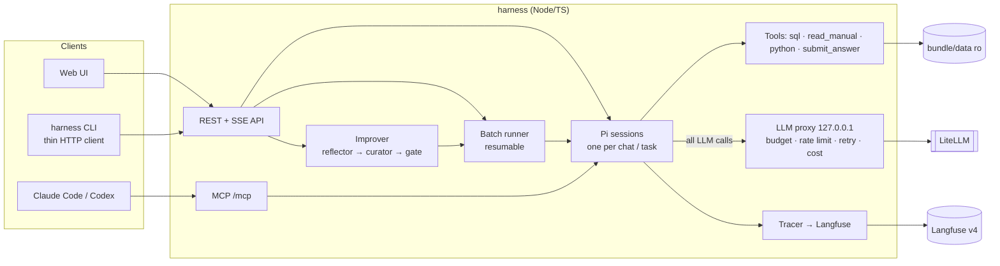

# Payments analyst on Pi — self-improving harness

Conversational analyst for the merchant-payments dataset, built on [Pi](https://pi.dev)
(`@earendil-works/pi-coding-agent@1.5.0`), with a self-improvement loop gated on the validation
set, cost/caching control and Langfuse tracing. Assignment: [`ASSIGNMENT.md`](ASSIGNMENT.md).
Full design, decisions and step status: [`SPEC.md`](SPEC.md).

> **Status: work in progress.** Done: LLM proxy + Pi sessions, data tools, answer validation,
> governor (budget / rate limit / retry), resumable batch runner, Langfuse tracing.
> Not yet: harness service in compose, UI, improver, MCP. See SPEC §6 for the plan.

## Architecture



Key points (details and trade-offs in SPEC §7):

- **Every LLM call goes through an in-process proxy** on a random loopback port. Only the proxy
  holds the LiteLLM key; it checks the budget, enforces rate limits and retries, and records the
  exact token usage and cost of each call (cache reads/writes included) in a SQLite ledger.
- **Prompt layout for caching:** instructions → rules manual → data schema → playbook are one
  stable prefix per harness version; the task goes into the user turn. Measured: ~88 % of input
  tokens served from cache across tasks in a batch.
- **The agent never sees gold answers.** The batch runner passes only question + guidelines; the
  DuckDB tool is sealed (no file access, SELECT only).

## Run

```bash
cp .env.example .env          # fill in LITELLM_BASE_URL and LITELLM_API_KEY
docker compose up -d          # Langfuse at http://localhost:3000 (admin@local.test / admin12345)
cd harness && npm ci
npm test                      # unit tests, no LLM spend
npm run test:live             # live LLM tests (cost cents)
```

`harness solve | improve | report`, the UI and MCP are added in the next steps (SPEC §6).

## Observability

Each task / chat turn is one Langfuse trace: an `agent` root, a `generation` per LLM call
(tokens, cache read/write, cost, latency) and a `tool` observation per tool call. Batch runs
share a Langfuse session (= run id); every observation carries the harness version.

Export / import of all Langfuse data (for the deliverable):

```bash
scripts/export-langfuse.sh langfuse-export.tar.gz
scripts/import-langfuse.sh langfuse-export.tar.gz && docker compose up -d
```

## Design decisions and trade-offs

See SPEC §7.

## With another week

_To be written at the end._
