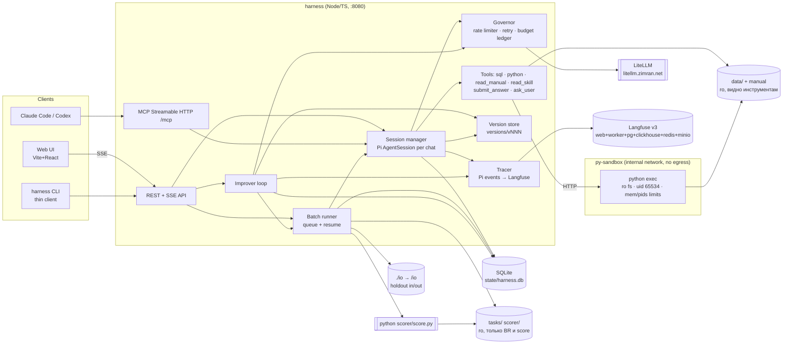

# SPEC — Self-improving payments analyst on Pi

Источники: `~/Desktop/ai-engineer-test-assignment/README.md` (далее «задание»), PDF, llm-access.md, ответы в чате.
Дата: 2026-11-06.

---

## 1. Цель и «готово, когда…»

**Цель.** Разговорный ИИ-аналитик на Pi по датасету платежей (DABStep-подобный: `payments.csv`, `fees.json`, `merchant_data.json`, `manual.md`), который улучшает свой харнесс сам, по гейту на val, с контролем стоимости, кэша и трейсингом в Langfuse.

**Готово, когда (проверяемо):**

| # | Критерий | Проверка |
|---|---|---|
| A1 | `git clone && cp .env.example .env && docker compose up` поднимает UI, API, MCP и Langfuse без ручных шагов | чистый клон в `/tmp`, `curl :8080/api/health` → 200, `curl :3000` (Langfuse) → 200 |
| A2 | `harness solve --tasks /io/<file>.jsonl --version best --out /io/answers.jsonl` (хостовая `./io` смонтирована в `/io`) пишет по строке на каждую задачу; если в задачах нет `answer` (holdout), скоринг пропускается без ошибки | val: `python scorer/score.py --tasks tasks/val.jsonl --answers io/answers.jsonl` → `missing: 0`; файл без `answer` → `solve` завершается `done`, `answers.jsonl` полный |
| A3 | `docker compose restart harness` посреди solve, повторный `solve` с тем же `--out` доделывает только оставшиеся задачи; задачи в `running` возвращаются в `pending`, оборванная последняя строка `answers.jsonl` отбрасывается | число **задач**, обработанных во втором запуске, = число не-`done` на момент рестарта |
| A4 | `harness improve --generations N --budget-usd X` создаёт версии; **≥ 2 промоушена** гейтом на val; отклонённые версии тоже сохранены | `harness report`: v000 `baseline` + ≥ 2 версии `promoted` + ≥ 1 `rejected` |
| A5 | Каждая версия хранит: дифф к родителю, val score, cost, cache hit rate, p50/p95 latency, статус | `versions/vNNN/metrics.json` + `diff.patch` |
| A6 | Чат: multi-turn (follow-up использует контекст), стрим шагов (tool calls) в UI, cost / cache-hit / ссылка на трейс на каждый ход | ручной сценарий: «fraud rate Crossfit_Hanna 2023» → «now split by card scheme» |
| A7 | На неоднозначном вопросе в чате агент задаёт уточнение (`ask_user`), а не отвечает | ручной сценарий: «what's the fee?» → уточняющий вопрос |
| A8 | Langfuse: trace на ход, generation на каждый LLM-вызов (tokens, cost, cacheRead/cacheWrite, latency), span на каждый tool call; session = чат-сессия / run | открыть трейс по ссылке из UI |
| A9 | Cache hit rate измерен и отчитан (`cache_read / (input + cache_read + cache_write)`) | `harness report`, REPORT.md |
| A10 | Глобальный кап $140 и per-turn / per-task лимиты реально останавливают работу | тест с `GLOBAL_BUDGET_USD=0.01` → 402 / run `stopped_budget` |
| A11 | 👍/👎 сохраняются и попадают во вход improver | `harness improve` логирует `feedback_items: N` |
| A12 | Version selector: чат с любой версией; rollback = смена `best` | UI + `POST /api/versions/:id/promote` |
| A13 | (Extra) MCP: ask (multi-turn по `session_id`, выбор версии), trace URL + cost, feedback; одна строка подключения для Claude Code / Codex | `claude mcp add --transport http payments http://localhost:8080/mcp` → вызов `ask` |
| A14 | Improver не трогает `data/`, `tasks/`, `scorer/`, не хранит ответы задач; инструменты агента не видят `tasks/` / `scorer/`; у python-sandbox нет egress | `sha256sum -c` по scorer; leak-check тест; vitest «tool не читает val.jsonl» (`sql`: `read_json_auto('…/val.jsonl')` → ошибка; `python`: `open('/bundle/tasks/val.jsonl')` → `FileNotFoundError`); `python`: `urllib.urlopen('https://example.com')` и `subprocess curl` → ошибка сети |

---

## 2. Архитектура

Один процесс `harness` (Node/TS) владеет **всеми** LLM-вызовами: агентом, improver, лимитером и бюджетом. CLI — тонкий HTTP-клиент к нему. Так rate limiter и бюджет общие для UI, MCP, batch и improver без Redis.



**Поток chat-хода:** UI `POST /turns` → SessionManager берёт Pi-сессию (версия фиксирована на сессию) → `session.prompt()` → события Pi → (a) SSE в UI, (b) Tracer → Langfuse, (c) Governor считает cost → агент вызывает `submit_answer` или `ask_user` → `turn.end` с cost / cache / trace_url.

**Поток improve:** родительская версия → её провалы на train (+ 👎) → reflection-LLM → патч → leak-check → smoke на подвыборке train → полный val → гейт → `promoted` (новый `best`) или `rejected`.

**Изоляция gold-ответов:** batch-runner читает `tasks/*.jsonl` сам и передаёт агенту **только `question` + `guidelines`**; `answer` не покидает BR / скорер. `tasks/` и `scorer/` не смонтированы в py-sandbox и недоступны `sql` (см. §4.4).

---

## 3. Ядро

### 3.1 Модели данных (TS-типы, хранятся в SQLite, кроме Version)

```ts
type VersionId = `v${string}`;            // v000, v001…
interface VersionManifest {               // versions/vNNN/manifest.json — в git, иммутабелен
  id: VersionId; parent: VersionId | null; created_at: string;
  status: 'baseline' | 'candidate' | 'promoted' | 'rejected';
  change_summary: string;                 // «что изменилось», 1–3 строки
  models: { analyst: string; reflector: string };   // model routing
  thinking: ThinkingLevel;                // enum Pi 1.x: 'off'|'minimal'|'low'|'medium'|'high'|'xhigh'|'max' (xhigh/max — только если модель поддерживает)
  limits: { max_tool_calls: number; max_turn_usd: number; max_turn_s: number };
  tool_descriptions: Record<ToolName, string>;      // правится improver'ом
}
// + versions/vNNN/{system.md, playbook.md, skills/<name>/{SKILL.md, *.py}, diff.patch, metrics.json}

interface VersionMetrics {
  val:   { correct: number; n: number; accuracy: number; by_level: Record<string, number> } | null;
  train_sample?: { correct: number; n: number };
  cost_usd: number; cost_per_task_usd: number;
  cache_hit_rate: number; latency_p50_s: number; latency_p95_s: number;
  gate?: GateDecision;
}

interface Session { id: string; version: VersionId; origin: 'ui' | 'mcp' | 'batch';
  created_at: string; status: 'idle' | 'running' | 'closed'; pi_session_file: string }

type TurnOutcome = 'answered' | 'clarification' | 'limit_exceeded' | 'error' | 'aborted';
interface Turn { id: string; session_id: string; idx: number; user_message: string;
  outcome: TurnOutcome; answer: string | null; assumptions: string[];
  usage: Usage; latency_ms: number; trace_id: string }

interface Usage { input: number; output: number; cache_read: number; cache_write: number;
  cost_usd: number; llm_calls: number; tool_calls: number }

interface Run { id: string; kind: 'solve' | 'improve_eval' | 'improve_smoke';
  version: VersionId; tasks_file: string; out_path: string;
  status: 'queued' | 'running' | 'done' | 'stopped_budget' | 'failed';
  budget_usd: number | null; usage: Usage; created_at: string }
interface RunTask { run_id: string; task_id: string;
  status: 'pending' | 'running' | 'done' | 'error'; attempts: number;
  answer: string | null; correct: boolean | null; turn_id: string | null }

interface Feedback { id: string; turn_id: string; rating: 'up' | 'down';
  comment: string | null; consumed_by: VersionId | null; created_at: string }

interface LedgerEntry { id: string; ts: string; scope: 'chat' | 'solve' | 'improve' | 'mcp';
  ref: string; cost_usd: number }       // SUM = глобальный расход

// Proposal — либо content, либо routing, никогда оба (иначе нельзя атрибутировать прирост)
type ContentOp =
  | { op: 'playbook_add' | 'playbook_edit' | 'playbook_remove'; rule_id?: string; text?: string }
  | { op: 'skill_upsert'; name: string; skill_md: string; files: Record<string, string> }
  | { op: 'tool_description'; tool: ToolName; text: string };
interface RoutingOp {                   // allow-list полей: только { model, thinking }
  op: 'routing';
  model?: 'claude-opus-5-5' | 'claude-sonnet-5-5' | 'claude-haiku-5-5' | 'gpt-6.1-sol' | 'gemini-3.8-flash'; // → models.analyst
  thinking?: ThinkingLevel;             // валидация по enum Pi SDK; лимиты/reflector improver не трогает
}
type Proposal =
  | { kind: 'content'; rationale: string; ops: ContentOp[] }
  | { kind: 'routing'; rationale: string; ops: [RoutingOp] };

interface GateDecision { parent_correct: number; cand_correct: number; wins: number; losses: number;
  confirmed_wins: number; easy_regressions: number; threshold_T: number;
  parent_cost_per_task: number; cand_cost_per_task: number;
  decision: 'promote' | 'reject'; reason: string }
```

### 3.2 Модули

| Модуль | Ответственность |
|---|---|
| `llm/provider` | Генерирует Pi `models.json`: провайдер `litellm`, `api: "anthropic-messages"` для claude-*, `openai-completions` для gpt / gemini; цены в `cost` для подсчёта Pi |
| `agent/session` | `createAgentSession({ modelRuntime, tools: [<только наши>], customTools })` (Pi 1.5) с `DefaultResourceLoader({ systemPromptOverride })`; схемы tools — TypeBox (`Type` из `@earendil-works/pi-ai`); skills из `versions/vNNN/skills`, `customTools`, `SessionManager` с файлом в `state/sessions/` |
| `agent/prompt` | Сборка system prompt в порядке, удобном для кэша: **[статичная инструкция → сжатый manual → схема данных → playbook]** → история → вопрос + guidelines |
| `agent/tools/*` | `sql`, `python`, `read_manual`, `submit_answer`, `ask_user` (контракты в §4.4) |
| `agent/validate` | Парсинг `guidelines` в `AnswerFormat` (`number{d}`, `list`, `scheme_name`, `merchant_name`, `grouped_list`, `yes_no`, `free`) и проверка ответа |
| `runtime/governor` | Семафор конкурентности + token bucket (RPM/TPM на модель), retry 429/5xx/ECONNRESET (exp backoff + jitter, 4 попытки), budget ledger с жёстким стопом |
| `obs/tracer` | Pi events → Langfuse SDK: trace на ход, generation на `message_end` assistant (usage из `message.usage`), span на `tool_execution_start/end`. Reflector improver'а тоже Pi-сессия (без tools) → идёт через тот же Tracer (trace `improve/<run>/gen<k>/reflect`) |
| `runs/batch` | Очередь RunTask, конкурентность N, идемпотентный append в `answers.jsonl`, resume по статусам в БД; агенту отдаёт только `question` + `guidelines`; `--tasks`/`--out` только под `/io` или `bundle/tasks` |
| `runs/score` | Вызов `python scorer/score.py --details` (скорер не импортируем и не копируем); пропускается, если хотя бы у одной задачи нет `answer` |
| `runs/splits` | Фиксированный (seed) стратифицированный по `level` сплит train: `improve` (≈ 150) и `report-holdout` (≈ 36). Хранится только список `task_id` в `config/splits.json`. Improver видит только `improve`-часть; `report-holdout` гоняется для REPORT («держится ли прирост вне val») |
| `improver/*` | `analyze` → `propose` → `leakcheck` → `smoke` → `validate` → `gate` |
| `versions/store` | Создание `vNNN` из родителя + Proposal, `diff.patch` (unified diff по дереву), указатель `versions/BEST` |
| `api`, `mcp`, `cli` | Транспорт поверх одного ядра |

### 3.3 Состояние хода и условия выхода

```
idle ──prompt──▶ running
running ──submit_answer(valid)──────────▶ answered        (exit)
running ──ask_user(q) [chat/mcp only]───▶ clarification   (exit; следующий user-msg продолжает сессию)
running ──submit_answer(invalid)────────▶ running         (tool error с причиной; ≤ 3 раз, затем принимаем как есть + флаг)
running ──limits (tool_calls | $ | s)───▶ limit_exceeded  (session.abort(); в batch ответ = лучший черновик или "Not Applicable")
running ──LLM error after retries───────▶ error
running ──global budget exhausted───────▶ aborted
```
- **Batch-режим:** `ask_user` не регистрируется; в промпт добавляется «если вопрос неоднозначен — выбери наиболее разумную трактовку и запиши её в `assumptions`». Ответ = последнее значение `submit_answer`.
- **Чат:** финальный текст агента + структурированный `answer` (если был `submit_answer`). `submit_answer` в чате необязателен: на свободные вопросы агент отвечает текстом.

### 3.4 Improver: состояния поколения

```
ANALYZE  ─ родитель: провалы на последнем прогоне train-`improve`-сплита (+ непотреблённые 👎), кластеризация по типу ошибки (format / wrong-filter / wrong-formula / NA-misuse / timeout)
PROPOSE  ─ reflector (Opus/Sonnet, Pi-сессия через Tracer) получает: текущие system/playbook/skills, ≤ 8 компактных трейсов провалов (вопрос, guidelines, шаги, ответ, «неверно»).
           Gold-ответ показываем ТОЛЬКО как «верно/неверно» + для чисел направление ошибки — значение не отдаём  → Proposal JSON
           (content XOR routing; routing — только allow-list {model, thinking}, thinking ∈ enum Pi SDK)
LEAKCHK  ─ отклонить, если в патче: task_id; ≥ 8-словная n-gram из любого question train/val; любой gold-ответ train/val длиной ≥ 4 символов как литерал;
           упоминание путей `tasks/`, `scorer/`, `*.jsonl`.
           Gold-литералы, которые встречаются как токены в `data/*`, `manual.md` или тексте guidelines (`GlobalCard`, `Rafa_AI`, `Not Applicable`, …), из словаря исключаются
SMOKE    ─ кандидат на (провалы из ANALYZE ∪ 15 случайных пройденных improve-train); продолжаем, если fixed − broken ≥ 2
VALIDATE ─ полный val (91)
GATE     ─ promote ⇔ (confirmed_wins − losses ≥ T) ∧ easy_regressions = 0 ∧ cand_cost_per_task ≤ 1.3 × parent_cost_per_task,
           где confirmed_wins — wins, подтверждённые перезапуском только «перевернувшихся» задач;
           T = max(2, |c₁ − c₂| + 1), c₁ / c₂ — correct двух прогонов v000 на val (считается до шага 13, пишется в config и REPORT)
PROMOTE  ─ status=promoted, BEST=vNNN, свежий train-sample(60) для следующего ANALYZE
REJECT   ─ status=rejected; ops и причина попадают в «негативную память» reflector'а (не повторять)
Выход: generations исчерпаны ∨ budget_usd исчерпан ∨ 3 rejected подряд ∨ глобальный кап
```

---

## 4. Контракты

### 4.1 REST API (`:8080`, JSON; ошибки `{ "error": { "code": string, "message": string } }`)

| Метод | Путь | Запрос | Ответ |
|---|---|---|---|
| GET | `/api/health` | — | `{ ok, langfuse, llm }` |
| POST | `/api/sessions` | `{ version?: "best" \| VersionId }` | `201 { session_id, version }` |
| GET | `/api/sessions/:id` | — | `{ session, turns: Turn[] }` |
| POST | `/api/sessions/:id/turns` | `{ message: string }` | `200 text/event-stream` (§4.2) |
| POST | `/api/sessions/:id/abort` | — | `202` |
| POST | `/api/feedback` | `{ turn_id, rating: "up"\|"down", comment? }` | `201 { id }` |
| GET | `/api/versions` | — | `VersionManifest & { metrics }[]` + `best` |
| GET | `/api/versions/:id/diff` | — | `text/x-diff` |
| POST | `/api/versions/:id/promote` | — | `200 { best }` (ручной rollback / forward) |
| POST | `/api/runs/solve` | `{ tasks_file, version, out, concurrency? }` — пути только под `/io/` или `bundle/tasks/`, иначе `400` | `202 { run_id }`. Тот же `out` + незавершённый run: если run жив — `200 { run_id }` (CLI переподключается к прогрессу), если остановлен — resume. Задачи без `answer` → скоринг пропущен, `correct: null` |
| POST | `/api/runs/improve` | `{ generations, budget_usd }` | `202 { run_id }` |
| GET | `/api/runs/:id` | — | `{ run, progress: { done, total, correct? }, usage }` |
| GET | `/api/runs/:id/events` | — | SSE прогресса |
| GET | `/api/report` | — | per-version metrics + total spend |
| GET | `/api/budget` | — | `{ cap_usd, spent_usd, remaining_usd }` |

**Коды ошибок:** `400 invalid_request` · `404 not_found` · `409 session_busy` (ход уже идёт) / `run_in_progress` · `402 budget_exhausted` (глобальный кап) · `422 version_invalid` · `503 llm_unavailable` (после ретраев) · `500 internal`.

### 4.2 SSE-события хода (`event: <type>`, `data: JSON`)

| type | data |
|---|---|
| `turn.start` | `{ turn_id, session_id, version, trace_url }` |
| `text.delta` | `{ delta }` |
| `thinking.delta` | `{ delta }` (если thinking включён) |
| `tool.start` | `{ call_id, tool, args }` |
| `tool.end` | `{ call_id, tool, ok, preview (≤ 2 KB), ms }` |
| `llm.usage` | `{ model, input, output, cache_read, cache_write, cost_usd, ms }` (на каждый LLM-вызов) |
| `clarification` | `{ question, options? }` |
| `answer` | `{ answer, assumptions[], format, valid }` |
| `turn.end` | `{ outcome, usage: Usage, cache_hit_rate, latency_ms, trace_url }` |
| `error` | `{ code, message }` |

Порядок гарантирован: `turn.start` → (…)* → `turn.end` | `error`. Heartbeat-комментарий каждые 15 с.

### 4.3 MCP (Streamable HTTP `/mcp` + stdio `harness mcp`)

| Tool | Вход | Выход |
|---|---|---|
| `ask` | `{ question, session_id?, version? = "best" }` | `{ session_id, turn_id, status: "answered"\|"needs_clarification", answer?, clarification_question?, assumptions, cost_usd, trace_url, version }` |
| `feedback` | `{ turn_id, rating: "up"\|"down", comment? }` | `{ ok }` |
| `list_versions` | `{}` | `[{ id, status, val_accuracy, is_best }]` |

Ответ на уточнение = следующий `ask` с тем же `session_id`. Через Governor и Tracer идёт тот же путь, что у UI (origin=`mcp`).

### 4.4 Инструменты агента

| Tool | Контракт |
|---|---|
| `sql` | `{ query: string }` → DuckDB in-process. На старте данные из `data/` грузятся в **таблицы**, затем `SET enable_external_access=false; SET lock_configuration=true` — `read_csv/read_json/COPY/ATTACH` к любым файлам невозможны. Таблицы: `payments`, `fees` (списки как `LIST`), `merchants`, `mcc`, `acquirer_countries`, хелпер-view `payments_m` с `month` из `day_of_year`. Результат: ≤ 200 строк в markdown + `row_count`; таймаут 20 с |
| `python` | `{ code: string }` → HTTP-вызов в сервис **`py-sandbox`** (§4.5): `python3` в `/work/<session>` (tmpfs), смонтированы только `data/` (ro) и `skills/` текущей версии (ro); pandas + duckdb; таймаут 60 с; stdout/stderr ≤ 8 KB. Сети нет на уровне docker (internal network) |
| `read_manual` | `{ section?: string, grep?: string }` → фрагмент `manual.md` (весь мануал в промпте сжат; полный текст по запросу) |
| `read_skill` | `{ name: string }` → `SKILL.md` из `versions/<v>/skills/<name>/` (только этот каталог). Встроенные Pi `read` / `bash` / `write` / `edit` **отключены** |
| `submit_answer` | `{ answer: string, assumptions?: string[] }` → `{ ok }` или ошибка `{ reason, expected_format }` |
| `ask_user` | `{ question: string, options?: string[] }` → завершает ход (только chat / mcp) |

### 4.5 Внешние контракты

- **LiteLLM:** `LITELLM_BASE_URL`, `LITELLM_API_KEY` из `.env` (в git только `.env.example`). Модели: `claude-opus-5-5`, `claude-sonnet-5-5`, `claude-haiku-5-5`, `gpt-6.1-sol`, `gemini-3.8-flash`. Для Claude используем Anthropic Messages (`/v1/messages`) с `cache_control` (Pi ставит его сам для `anthropic-messages`). **Предположение, проверяется в шаге 1.** Fallback: `openai-completions` с ручными `cache_control` в content-блоках.
- **Факты пробника (шаг 1, 2026-11-06, LiteLLM 1.106.6):** все 5 моделей в `/v1/models`; `/v1/messages` + `cache_control` работает для Sonnet и Haiku (запись → чтение 18 411 токенов на 2-м вызове). Цены, выведенные из `x-litellm-response-cost-*`, $/Mtok:

  | модель | input | output | cache write (5m) | cache read |
  |---|---|---|---|---|
  | claude-sonnet-5-5 | 2.00 | 10.00 | 2.50 | 0.10 |
  | claude-haiku-5-5 | 0.10 | 0.50 | 0.125 | 0.01 |

  Заголовков `x-ratelimit-*` прокси **не отдаёт** → Governor стартует со статических лимитов из env и снижает темп на 429. Каждый ответ несёт `x-litellm-response-cost` (+ разбивку input / output / cache) — это точная стоимость вызова от самого прокси. Opus / gpt / gemini ценами пока не проверены.
- **Стоимость:** первично `usage.cost` из Pi (по ценам в `models.json`); в конце run сверяемся с `GET /key/info` LiteLLM (spend по ключу), расхождение > 10% → warning в report.
- **Langfuse v3** (self-hosted, официальный compose): `LANGFUSE_HOST=http://langfuse-web:3000`, ключи проекта задаются через `LANGFUSE_INIT_*` env, поэтому работает из чистого клона без ручной настройки.
- **Песочница `py-sandbox`** (отдельный compose-сервис): только сеть `sandbox` с `internal: true` (нет egress; harness подключён к ней и к default), `read_only: true` + tmpfs `/work`, `user: "65534:65534"`, `mem_limit: 1g`, `pids_limit: 128`, `cpus: 1`, `cap_drop: [ALL]`, `no-new-privileges`. Mounts: `bundle/data:ro`, `versions:ro`. **Нет** `tasks/`, `scorer/`, `state/`, `.env`. Минимальный exec-сервер (POST `/exec {code, session, version}` → `{stdout, stderr, exit, ms}`).
- **harness:** `bundle/data`, `bundle/tasks`, `bundle/scorer` `:ro`; `./io:/io` (rw); egress нужен только на LiteLLM и Langfuse (внутри compose). Сетевой allow-list для самого harness не ставим (§7).
- **Скорер:** только как subprocess; при старте проверяем `sha256(scorer/score.py) == scorer/SHA256`, иначе отказ.

---

## 5. Структура папок

```
zimran-task/
├── SPEC.md  README.md  REPORT.md
├── docker-compose.yml          # harness + langfuse stack
├── .env.example  .gitignore    # .env, state/ в ignore
├── bundle/                     # копия задания: data/ tasks/ scorer/ (ro-mount, не трогаем)
├── harness/
│   ├── Dockerfile  package.json  tsconfig.json
│   ├── src/
│   │   ├── config.ts
│   │   ├── llm/{provider.ts, pricing.ts}
│   │   ├── agent/{session.ts, prompt.ts, validate.ts}
│   │   ├── agent/tools/{sql.ts, python.ts, manual.ts, submit.ts, ask_user.ts}
│   │   ├── runtime/{governor.ts, limiter.ts, retry.ts, budget.ts}
│   │   ├── obs/tracer.ts
│   │   ├── runs/{batch.ts, score.ts}
│   │   ├── improver/{loop.ts, analyze.ts, propose.ts, leakcheck.ts, smoke.ts, gate.ts}
│   │   ├── versions/store.ts
│   │   ├── db/{schema.sql, db.ts}
│   │   ├── api/{server.ts, sse.ts, routes/*.ts}
│   │   ├── mcp/server.ts
│   │   └── cli/harness.ts
│   └── test/                   # vitest
├── py-sandbox/                 # Dockerfile + exec-сервер (python, pandas, duckdb)
├── config/splits.json          # task_id для improve / report-holdout (без ответов)
├── io/                         # mount /io: holdout-задачи и answers.jsonl (в .gitignore, кроме .keep)
├── web/                        # Vite + React, собирается в harness/public
│   └── src/{pages/Chat.tsx, pages/Improvements.tsx, components/*}
├── versions/
│   ├── BEST                    # "v003"
│   └── v000/ {manifest.json, system.md, playbook.md, skills/, metrics.json, diff.patch}
├── scripts/{export-langfuse.sh, import-langfuse.sh, clean-clone-test.sh}
└── state/                      # volume: harness.db, sessions/, runs/, work/
```

---

## 6. План (от самого рискованного)

Порядок исполнения: **1–8 → 9 (baseline в фоне) → 14–15 (тонкий чат) → 10–12 → 13 (improve в фоне) → 16–18 → 19–20**. Номера шагов — идентификаторы, не порядок.

| # | Шаг (15–30 мин) | Готово, когда… |
|---|---|---|
| 1 ✅ | **Пробник LiteLLM:** `/v1/models`, `/v1/messages` для Sonnet/Haiku с `cache_control`, два одинаковых запроса; заголовки rate-limit / cost | на 2-м запросе `cache_read_input_tokens > 0`; записаны цены, `x-ratelimit-*` (→ RPM/TPM Governor) |
| 2 | **Pi + LiteLLM** через SDK: `models.json`, одна сессия, `customTools` с тестовым tool, подписка на события | скрипт печатает `tool_execution_start/end` и `message.usage.cacheRead > 0` на 2-м ходе |
| 3 | **Langfuse в compose** + Tracer на событиях Pi. **Time-box 40 мин** на v3 (web+worker+pg+clickhouse+redis+minio); не взлетел → fallback **Langfuse v2 + Postgres** (тот же JS SDK, тот же Tracer) | `docker compose up` → трейс с generation (tokens / cost / cacheRead) и tool-span виден в UI Langfuse |
| 4 ✅¹ | **Tools `sql` + `read_manual`**, DuckDB-таблицы + `enable_external_access=false`, промпт v000 (manual + схема); BR отдаёт агенту только question + guidelines | 3 easy train-задачи верно через `harness-dev ask`; vitest: `sql` с `read_json_auto('…/val.jsonl')` → ошибка |
| 5 | **`validate` + `submit_answer`** | vitest: валидатор принимает **все** gold-ответы train+val в их guidelines (277/277, включая 3 пустых `''`) и отвергает 10 заведомо кривых |
| 6 | **Governor:** семафор, token bucket (RPM/TPM из шага 1, адаптивное снижение на 429), retry, ledger, per-turn и per-task лимиты | vitest с fake-LLM: 429 → ретрай; кап $0.01 → `budget_exhausted`; лимит tool_calls → `limit_exceeded`; per-task $ превышен → задача `error` |
| 7 | **Batch runner + `harness solve`** (CLI → API), `/io`-mount, resume, пропуск скоринга без `answer`, `config/splits.json` | `solve` на 10 train → скорер; A3 (restart посередине); файл без `answer` → `done` |
| 8 | **`py-sandbox`** (internal network, ro, uid 65534, mem/pids limits) + tool `python` + `read_skill` | `python` считает то же, что `sql`, на 1 задаче; A14: `open(val.jsonl)` → `FileNotFoundError`, `urllib` / `subprocess curl` → ошибка сети |
| 9 | **Baseline v000 (фон):** выбор модели на 20 improve-train (Haiku vs Sonnet), затем **2× val**, improve-train, report-holdout. Метрики пишутся в БД (run-уровень); `metrics.json` материализуется в шаге 10 | в БД есть 4 run'а v000; посчитан порог `T` (§3.4) и $/task |
| 14 | **API сессий + SSE**, multi-turn, `ask_user` | `curl -N` показывает поток событий; follow-up использует контекст |
| 15 | **UI Chat (тонкий):** стрим шагов, cost / cache / trace-ссылка, 👍/👎, version selector | ручной сценарий A6 / A7 |
| 10 | **Version store + `harness report`** (`metrics.json` из БД, `diff.patch`, bind-mount `./versions`; rejected-версии тоже в git) | `report` печатает таблицу с v000; `diff.patch` генерируется |
| 11 | **Improver: analyze → propose → leakcheck** (reflector — Pi-сессия через Tracer; content XOR routing; allow-list) | валидный Proposal на провалах v000; leak-тесты: gold-литерал → reject, `GlobalCard`/`Not Applicable` в правиле → pass, путь `tasks/` → reject; reflect-трейс виден в Langfuse |
| 12 | **Improver: smoke → validate → gate → promote/reject** (T из шага 9, confirmed_wins, cost-guard ×1.3) | 1 поколение end-to-end, `GateDecision` записан в metrics |
| 13 | **Прогон improve (фон, бюджет ≤ $60)**, пока идут шаги 16–18 | ≥ 2 `promoted` |
| 16 | **UI Improvements:** таблица версий, дифф, кнопка «improve» с бюджетом, promote/rollback | запуск improve из UI виден в прогрессе |
| 17 | **👎 → improver** | `improve` логирует `feedback_items > 0`, 👎-ход попадает в ANALYZE |
| 18 | **MCP** (Streamable HTTP; stdio = прокси к `:8080`, чтобы шёл через общий Governor) | Claude Code и Codex: `ask` → `needs_clarification` → `ask` с session_id → `answered` |
| 19 | **Чистый клон** | `scripts/clean-clone-test.sh` зелёный (A1, A2 включая holdout-файл без `answer`) |
| 20 | **Финализация deliverables** (§9): заморозка best, report-holdout для best, экспорт Langfuse, README / REPORT | чек-лист §9.3 закрыт |

¹ Без LLM-части: смоук «3 easy train-задачи через агента» выполняется после шага 2 (Pi + LiteLLM).

**Сквозные шаги deliverables (не в конце, а по ходу):**
- после шага 3 — скелет `README.md` (mermaid из §2, «как запустить»), дальше дописываю по мере готовности;
- с шага 9 — `harness report --md > REPORT.md` генерирует таблицы автоматически; каждый прогон сразу пишет метрики, руками только «что не сработало»;
- после каждого промоушена — `git commit` версии (`versions/vNNN` + `BEST`), чтобы история версий была в git, а не только в БД;
- `scripts/export-langfuse.sh` пишется вместе с шагом 3 и проверяется импортом в чистый volume сразу, а не в последний час.

**Бюджет ($150, кап $140; оценка при ≈ $0.10/task):** шаги 1–8 ≈ $5 · baseline (2×20 + 2×91 + 150 + 36 ≈ 408 задач) ≈ $41 · improve ≈ $60 · report-holdout best + финальный val + демо ≈ $10 · резерв $24. Если шаг 9 покажет > $0.15/task — ANALYZE на improve-train-sample(60) вместо 150 и improve ≤ 3 поколений.

---

## 7. Решения и компромиссы

| Решение | Почему | Цена |
|---|---|---|
| Один процесс владеет всеми LLM-вызовами, CLI = HTTP-клиент | общий лимитер и бюджет без Redis / распределённых локов | `harness solve` требует поднятый сервис (`docker compose exec harness harness solve …`, задокументировать в README); масштаб = один узел |
| Pi через SDK (`createAgentSession`), а не RPC-процесс на сессию; `@earendil-works/pi-coding-agent@1.5.0` (версия зафиксирована точно; API сверено по context7 `/earendil-works/pi/v1.4.0` и `/websites/pi_dev`) | прямой доступ к событиям / usage, нет IPC, проще трейсинг | больше привязки к SDK-API Pi 1.x (`ModelRuntime`, `tools` allow-list, TypeBox-схемы); апгрейд Pi — только осознанно |
| Встроенные `bash` / `write` / `edit` Pi отключены, свои `sql` / `python` | контроль песочницы, предсказуемые tool-span'ы в Langfuse | теряем «универсальность» coding-агента |
| Claude через `anthropic-messages` | явный `cache_control`, измеримый `cache_read` | зависит от того, пропускает ли LiteLLM `/v1/messages` (шаг 1) |
| Порядок промпта: статика → manual → схема → playbook → история → вопрос | максимальный общий префикс между задачами | правка playbook инвалидирует кэш версии (это нормально: версия = новый префикс) |
| **Batch: `ask_user` выключен, трактовка + `assumptions` в трейс** (ваш ответ: в задании нет разрешения конфликта) | скорер засчитывает уточнение как ошибку | в batch агент «угадывает», что формально противоречит «clarifies instead of guessing» |
| **Improver может писать playbook, skills / хелперы, описания tools, routing** (README §2.2 разрешает) | хелперы (матчинг fee-правил, месячные агрегаты) дают больше, чем текст промпта | риск переобучения → leak-check + gate на val |
| Reflector не видит значений gold-ответов, только верно/неверно (+ направление для чисел) | снижает риск зашивания ответов | ему сложнее найти причину ошибки |
| Гейт: `confirmed_wins − losses ≥ T` (T из шума двух прогонов v000) ∧ 0 регрессий easy ∧ cost ≤ 1.3× родителя | 91 задача → 1 задача = 1.1 п.п.; прирост нельзя «купить» дорогой моделью | часть реальных улучшений будет отклонена; повторы flipped-задач и второй baseline стоят денег |
| Proposal = content XOR routing; routing только `{model, thinking}` | прирост атрибутируется одному типу изменения | больше поколений на комбинированные улучшения |
| Train делится на improve (≈150) и report-holdout (≈36) | независимая проверка «держится ли прирост» вне val, по которому отбираем | improver видит меньше провалов |
| v000 содержит человеческий «domain primer» (данные важнее readme, `[]` = `null` = любое, fraud = fraud_vol / total_vol, маппинг capture_delay) | ответы на ваши вопросы 7; не тратим бюджет improver на очевидное | меньше «места» для демонстрации self-improvement |
| Версии в git (`versions/`), рантайм-состояние в SQLite (volume) | frozen best и история едут с клоном | метрики дублируются в `metrics.json` и БД |
| Бюджет $150, кап $140 | запас на демо и holdout-проверку | improve ограничен ~4–6 поколениями |
| Код агента (python) — в отдельном `py-sandbox` в internal-сети без egress; сам `harness` сетевым allow-list не ограничен | исполняемый LLM-код физически не выходит наружу и не видит `tasks/`; allow-list-прокси для harness — часы работы | harness (наш код, не LLM-код) формально может выйти в интернет; закрываем ревью кода + LLM только через LiteLLM baseUrl |
| Анализ на train-sample(60), а не на full train каждое поколение | экономия ~$15 на поколение | ANALYZE видит не все провалы |

---

## 8. Что режем, если не успеваем (по порядку)

1. MCP stdio-транспорт (оставить только HTTP).
2. MCP целиком (Extra mile).
3. Кнопка запуска improve из UI (оставить CLI; таблица версий остаётся).
4. Подтверждение flipped-задач в гейте (оставить `cand − parent ≥ T` / 0 регрессий easy / cost-guard).
5. Smoke-этап improver (сразу val; дороже, но проще).
6. 👎 → improver (хранить 👎, но не подавать в ANALYZE) — **Should**.
7. Tool `python` (только `sql` + skills в виде SQL-шаблонов).
8. Сверка cost с LiteLLM `/key/info`.
9. Version selector в UI (версия через query-param).

**Не режем (Must):** multi-turn агент на Pi, чат со стримом шагов, improver с ≥ 2 промоушенами по val, Langfuse с cost / cache, `harness solve / improve / report`, `docker compose up` из чистого клона.

---

## 9. Deliverables (задание §7) — план заранее

### 9.1 Что, откуда, когда

| # | Deliverable | Как получается | Когда начинаем | Проверка |
|---|---|---|---|---|
| D1 | **Git repo**, `docker compose up` из чистого клона | `bundle/` (данные, задачи, скорер) в репо, `.env.example`, compose со всеми сервисами; без локальных путей и ручных шагов | шаг 3 (compose), финал — шаг 19 | `scripts/clean-clone-test.sh`: `git clone` во временную папку → `cp .env.example .env` + ключ → `up -d` → health → `solve` на 3 задачах |
| D2 | **README.md** | Архитектура (mermaid из §2), как запустить (compose, CLI в контейнере, MCP one-liners для Claude Code / Codex), решения и компромиссы (из §7), «что бы сделал за ещё неделю» | скелет после шага 3, дополняется на каждом шаге | все команды из README выполнены в clean-clone-test |
| D3 | **REPORT.md** | Автогенерация `harness report --md`: per-version val (по уровням), cost, $/task, cache hit rate, p50/p95, change_summary, gate decision, promoted / rejected, total spend (ledger + сверка с LiteLLM `/key/info`). Руками: «что не сработало», оценка шума | с шага 9 (baseline) | цифры в REPORT совпадают с `/api/report` и Langfuse |
| D4 | **Frozen `best`** | `versions/BEST` + каталог версии в git, тег `best-frozen`; `manifest.json` фиксирует модели / thinking / лимиты; `harness solve --tasks /io/holdout.jsonl --version best --out /io/answers.jsonl` читает версию только из репо; holdout кладут в `./io/` | после последнего промоушена | `git checkout best-frozen && solve` на val даёт тот же score ± T; файл без `answer` отрабатывает |
| D5 | **Langfuse data** | `scripts/export-langfuse.sh`: `pg_dump` (Postgres) + `clickhouse-backup` / `BACKUP TABLE … TO File` (ClickHouse) + `mc mirror` (MinIO) → `langfuse-export.tar.zst` (+ `import-langfuse.sh`). Дополнительно JSON-экспорт трейсов отчётных run'ов через публичный API Langfuse (запасной вариант, если volume не поднимется) | шаг 3 (скрипт и проверка импорта) | импорт в чистый compose → трейсы отчётных run'ов открываются по `trace_url` из REPORT |

### 9.2 Что фиксировать по ходу (иначе потом не восстановить)

- Каждый run хранит `run_id`, `version`, `git sha`, модели, конкурентность, стоимость и Langfuse `session_id` = `run_id`. REPORT ссылается на трейсы через них.
- **Шум:** baseline v000 на val прогоняем **дважды** (≈ $10) → получаем разброс между прогонами одной версии, это основа раздела «насколько уверены, что прирост реален». Плюс бутстреп-ДИ по задачам и парные wins / losses из гейта.
- Отклонённые версии и причины не удаляются — это часть REPORT («что не сработало»).
- Метрика кэша считается из usage каждого LLM-вызова, а не предполагается: `cache_read / (input + cache_read + cache_write)` per version и per run.
- Total spend: ledger в SQLite + снимок `GET /key/info` LiteLLM в начале и в конце дня.

### 9.3 Финальный чек-лист сдачи

- [ ] `clean-clone-test.sh` зелёный на свежем клоне
- [ ] `versions/BEST` указывает на финальную версию, тег `best-frozen` стоит
- [ ] `sha256` скорера совпадает, `bundle/` не изменён (`git diff --stat bundle/` пуст)
- [ ] в репо нет `.env` и ключа (`git grep sk-` пуст)
- [ ] REPORT.md: таблица версий, total spend, шум, «что не сработало», уверенность
- [ ] README.md: диаграмма, запуск, MCP one-liners, решения, «ещё неделя»
- [ ] `langfuse-export.tar.zst` проверен импортом; ссылка или файл приложен
- [ ] zip / ссылка на репо отправлены
